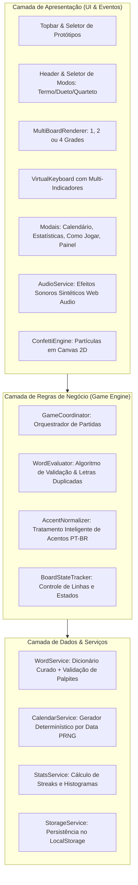

# Documento de Projeto Técnico (TDD) — Jogo Casual de Palavras
**Projeto:** Palavreio (Joguinho de Palavras do Pedro)  
**Versão:** 1.0  
**Data:** 14 de Outubro de 2026  
**Status:** Pronto para Implementação / Especificação de Engenharia  
**Stack Principal:** HTML5 Semântico, CSS3 Moderno (Custom Properties & Dynamic Viewport), JavaScript Vanilla (ES6+ Modular), Web Audio API, Web Storage API, PWA (Service Worker)  

---

## 1. Visão Geral da Arquitetura

O sistema é concebido como uma **Single Page Application (SPA) Ultraleve e Offline-First**, executada 100% no cliente (*client-side*), com zero dependências de frameworks pesados no runtime (como React ou Vue), garantindo:
- **Tempo de Primeiro Carregamento (FCP):** < 400ms.
- **Tamanho Total dos Assets:** < 150 KB (incluindo dicionários e fontes).
- **Consumo de Memória:** Estável (< 30 MB em execução).
- **Compatibilidade:** Navegadores móveis e desktop modernos (Chrome, Safari iOS, Firefox, Edge).

### 1.1 Diagrama de Arquitetura em Camadas



---

## 2. Estrutura de Diretórios e Módulos

```text
joguinho-do-pedro/
├── index.html              # Estrutura semântica principal e modais
├── styles.css              # Design System, variáveis CSS, temas e layout responsivo
├── words.js                # Banco de palavras PT-BR curadas e serviço de busca
├── app.js                  # Motor da partida, orquestração multi-board e calendário
├── server.js               # Servidor local leve de desenvolvimento em Node.js
├── manifest.json           # Configuração de PWA (Instalação no Celular/Desktop)
├── sw.js                   # Service Worker para cache e funcionamento 100% offline
├── PRD.md                  # Documento de Requisitos do Produto (v1.1)
└── TECHNICAL_DESIGN.md     # Este documento de arquitetura técnica
```

---

## 3. Modelagem de Dados & Tipagem (Interfaces TypeScript)

```typescript
/** Modos de jogo disponíveis */
export type GameFormat = 'termo' | 'dueto' | 'quarteto';

/** Estado de cada letra avaliada */
export type LetterStatus = 'correct' | 'present' | 'absent' | 'empty';

/** Configuração dos formatos */
export interface FormatConfig {
  name: string;
  wordCount: number;      // 1 (Termo), 2 (Dueto), 4 (Quarteto)
  maxAttempts: number;    // 6 (Termo), 7 (Dueto), 9 (Quarteto)
  containerClass: string;
}

/** Estado de um tabuleiro individual */
export interface BoardState {
  boardIndex: number;
  targetWord: string;     // Ex: "FERRO"
  isSolved: boolean;
  solvedAtAttempt: number | null;
  grid: {
    letter: string;
    status: LetterStatus;
    accentedChar?: string; // Glifo original acentuado (ex: 'Ã')
  }[][];
}

/** Estado global da partida ativa */
export interface GameSession {
  format: GameFormat;
  dateStr: string;        // "2026-10-14" ou "random_xyz"
  isPractice: boolean;    // true se for modo livre/replay
  currentAttempt: number;
  currentLetters: string[]; // 5 posições de digitação ativa
  boards: BoardState[];
  isGameOver: boolean;
  hasWon: boolean;
  historyGuesses: string[];
}

/** Histórico persistido por dia e formato no LocalStorage */
export interface MatchRecord {
  dateStr: string;
  format: GameFormat;
  won: boolean;
  attempts: number;
  targetWords: string[];
  timestamp: number;
}

/** Estatísticas consolidadas do jogador */
export interface PlayerStats {
  played: number;
  wins: number;
  currentStreak: number;
  maxStreak: number;
  distribution: Record<number, number>; // 1..9 -> quantidade de vitórias
}
```

---

## 4. Algoritmos e Regras de Negócio Críticas

### 4.1 Algoritmo de Avaliação de Letras e Resolução de Duplicadas
O maior ponto de erro em clones ingênuos de Wordle é o tratamento de letras repetidas.
*Regra canônica:* Se a palavra secreta for **`TERRA`** (dois 'R') e o palpite for **`ROCHA`** (um 'R'):
- A letra 'R' no palpite deve ser **amarela** (presente).
- Se o palpite for **`ARARA`** (três 'A', mas 'TERRA' tem apenas um 'A' no final):
  - O último 'A' fica **verde** (posição exata).
  - Os outros dois 'A' devem ficar **cinzas** (excederam as ocorrências disponíveis).

#### Algoritmo em 2 Passadas:
```javascript
function evaluateGuess(guess, targetWord) {
  const result = new Array(5).fill('absent');
  const targetChars = targetWord.split('');
  const guessChars = guess.split('');

  // 1ª Passada: Identificar todas as correspondências exatas (Verde)
  for (let i = 0; i < 5; i++) {
    if (guessChars[i] === targetChars[i]) {
      result[i] = 'correct';
      targetChars[i] = null; // Letra consumida
      guessChars[i] = null;
    }
  }

  // 2ª Passada: Identificar letras presentes fora de posição (Amarelo)
  for (let i = 0; i < 5; i++) {
    if (guessChars[i] !== null) {
      const foundIndex = targetChars.indexOf(guessChars[i]);
      if (foundIndex !== -1) {
        result[i] = 'present';
        targetChars[foundIndex] = null; // Letra consumida
      } else {
        result[i] = 'absent';
      }
    }
  }

  return result;
}
```

---

### 4.2 Algoritmo de Normalização de Acentos PT-BR
Para eliminar a fricção no teclado móvel, o jogador digita caracteres sem diacríticos (`A-Z`). O sistema mapeia os termos equivalentes:

```javascript
const DIACRITICS_MAP = {
  'A': ['A', 'Á', 'À', 'Â', 'Ã'],
  'E': ['E', 'É', 'Ê'],
  'I': ['I', 'Í'],
  'O': ['O', 'Ó', 'Ô', 'Õ'],
  'U': ['U', 'Ú'],
  'C': ['C', 'Ç']
};

function normalizeString(str) {
  return str.normalize('NFD').replace(/[\u0300-\u036f]/g, '').toUpperCase();
}
```
Na revelação, o caractere original acentuado da lista canônica é recuperado e injetado na grade, proporcionando legibilidade ortográfica impecável.

---

### 4.3 Gerador Determinístico por Data (PRNG) para o Calendário
Para que todos os jogadores compartilhem a mesma palavra diária em qualquer data passada ou presente sem necessidade de um backend dedicado, utiliza-se uma função hash determinística baseada na distância de dias:

```javascript
function getDayIndex(dateString) {
  const epoch = new Date('2026-01-01T00:00:00');
  const target = new Date(`${dateString}T00:00:00`);
  return Math.floor((target - epoch) / (1000 * 60 * 60 * 24));
}

function getWordForDay(dayIndex, offset = 0) {
  // Coeficientes primos garantem dispersão pseudoaleatória uniforme
  const index = Math.abs((dayIndex * 137 + offset * 79 + 31) % ALL_VALID_WORDS.length);
  return ALL_VALID_WORDS[index];
}

// Termo: getWordForDay(dia, 0)
// Dueto: getWordForDay(dia, 0) e getWordForDay(dia, 1)
// Quarteto: getWordForDay(dia, 0..3)
```

---

### 4.4 Coordenação Multi-Board (Dueto e Quarteto)
1. **Entrada Sincronizada:** Ao pressionar qualquer tecla, o caractere é replicado na linha ativa de **todos os tabuleiros não resolvidos**.
2. **Avaliação Isolada:** Ao confirmar com `Enter`, cada tabuleiro calcula de forma independente o status de cores para a sua respectiva palavra alvo.
3. **Bloqueio Parcial (*Locking*):** Se o Tabuleiro 1 for acertado no palpite 3, ele entra em estado `.board-solved`:
   - Seus blocos ganham destaque e param de receber palpites futuros.
   - O jogador prossegue digitando no Tabuleiro 2 a partir do palpite 4.
4. **Condição de Vitória:** Quando `state.solvedBoards.every(s => s === true)` for satisfeito.
5. **Teclado com Multi-Indicadores:** Cada tecla contém um sub-container `.key-multi-indicator` com 2 ou 4 pontos (`.key-dot`), cada um exibindo o status relativo àquele tabuleiro específico.

---

## 5. Engenharia de Layout & Solução Anti-Sobreposição

### 5.1 O Desafio Físico de Viewport
Em dispositivos móveis e telas compactas de laptop (600px - 750px de altura útil), empilhar:
- Barra superior de ferramentas (~45px)
- Cabeçalho do jogo (~45px)
- Seletor de modo (~36px)
- Grade de até 9 linhas de altura (no Quarteto ou Dueto)
- Teclado virtual completo com 3 linhas (~160px)
- Rodapé e margens (~40px)

Pode causar colisões e sobreposição do teclado sobre a grade se forem usadas dimensões estáticas.

### 5.2 A Solução Matemática com Variáveis CSS Dinâmicas

A aplicação utiliza um cálculo reativo de `--tile-size` amarrado dinamicamente a `100dvh` (Dynamic Viewport Height):

```css
:root {
  /* No Termo clássico (6 linhas): */
  --tile-size: min(52px, calc((100dvh - 370px) / 6), calc((100vw - 44px) / 5));
}

/* No Dueto (7 linhas, 2 tabuleiros lado a lado): */
.board-area-dueto .board-grid {
  --tile-size: min(34px, calc((100vw - 64px) / 10), calc((100dvh - 380px) / 7));
}

/* No Quarteto (9 linhas, grade 2x2): */
.board-area-quarteto .board-grid {
  --tile-size: min(23px, calc((100vw - 68px) / 10), calc((100dvh - 390px) / 9));
}
```

#### Regras de Ouro no Flexbox:
1. `.keyboard-container { flex-shrink: 0; }` — **Blindagem:** O teclado nunca diminui nem é empurrado por outros elementos.
2. `.app-header { flex-shrink: 0; }` e `.mode-switch-wrapper { flex-shrink: 0; }`.
3. `.board-container { flex: 1 1 auto; min-height: 0; overflow: hidden; }` — O container da grade ocupa exclusivamente o espaço excedente central.
4. As peças utilizam `width: var(--tile-size); height: var(--tile-size);` e a tipografia escala via `font-size: calc(var(--tile-size) * 0.55);`.

---

## 6. Design System & Direção Visual Escolhida

### 6.1 Identidade Visual Primária: *Midnight Emerald (Dark Luxury)*
- **Fundo Global:** `#070B14` (Ardósia cósmica profunda, reduz cansaço visual e economiza bateria em telas OLED).
- **Cartões e Superfícies:** `#0E1626` com bordas sutis `rgba(255, 255, 255, 0.08)`.
- **Verde Esmeralda (Correto):** `#10B981` com borda `#059669` e glow sutil `0 0 20px rgba(16, 185, 129, 0.25)`.
- **Âmbar Ouro (Presente):** `#F59E0B` com borda `#D97706`.
- **Grafite Escuro (Ausente):** `#253347`.
- **Teclas do Teclado:** `#1A2538` com sombra tátil `0 3px 0 rgba(0, 0, 0, 0.4)`.

---

## 7. Acessibilidade (WCAG 2.2 Nível AAA)

1. **Dual-Coding para Daltonismo:** Ativação instantânea pelo botão "Modo Daltônico", inserindo badges de forma geométrica no canto inferior direito de cada peça:
   - `✓` para acerto exato.
   - `↔` para letra presente em outra posição.
   - `✕` para letra ausente.
2. **Relação de Contraste:** Mínimo de 7:1 entre o texto das peças e os fundos preenchidos.
3. **Árvore de Acessibilidade (ARIA):**
   - Grade principal declarada com `role="grid"` e `aria-readonly="true"`.
   - Linhas declaradas com `role="row"`.
   - Células declaradas com `role="gridcell"` e `aria-label="Linha X, letra Y: [Caractere], [Status]"`.
   - Avisos dinâmicos gerenciados por container com `role="status"` e `aria-live="polite"`.

---

## 8. Persistência de Dados & Estrutura do LocalStorage

Todas as partidas e configurações são mantidas no dispositivo do usuário sem dependência de banco remoto:

| Chave no `localStorage` | Tipo de Dado | Propósito |
| :--- | :--- | :--- |
| `wordgame_match_{YYYY-MM-DD}_{format}` | `JSON (MatchRecord)` | Salva o status de cada dia (vitória, tentativas, palavras) para exibição no calendário. |
| `wordgame_player_stats` | `JSON (PlayerStats)` | Total de partidas, vitórias, sequência atual, melhor sequência e distribuição. |
| `wordgame_theme` | `string` | Tema ativo (`midnight`, `neon`, `editorial`). |
| `wordgame_colorblind` | `boolean` | Flag de ativação dos símbolos de daltonismo. |
| `wordgame_sound` | `boolean` | Flag de ativação dos efeitos sonoros. |

---

## 9. Plano de Testes e Validação Técnica

### 9.1 Matriz de Testes de Casos Limítrofes (Edge Cases)

| Cenário de Teste | Entrada / Ação | Comportamento Esperado |
| :--- | :--- | :--- |
| **Letras Duplicadas 1** | Alvo: `FERRO`, Palpite: `ROCHA` | 1º 'R' fica amarelo; demais letras avaliadas normalmente. |
| **Letras Duplicadas 2** | Alvo: `TERMO`, Palpite: `ARARA` | 'R' na posição 3 fica verde; 'R' na posição 1 fica cinza. |
| **Palavra com Acento** | Digitação: `M A C A` no teclado normal | Sistema aceita e valida a palavra canônica `MAÇÃ`. |
| **Palpite Inválido** | Digitação: `XXXXX` + Enter | Animação de tremor (*shake*), aviso *"Palavra não encontrada"* e não consome tentativa. |
| **Dueto Conclusão Parcial** | Tabuleiro 1 acertado na tentativa 2 | Tabuleiro 1 ganha classe `.board-solved`, bloqueia novas edições e o Tabuleiro 2 segue ativo. |
| **Replay Imediato** | Clique em "Nova Palavra" pós-vitória | Reseta os tabuleiros e teclado instantaneamente com novas palavras sorteadas, sem travar por 24h. |
| **Navegação Calendário** | Clique no dia 05 do mês no calendário | Carrega exatamente as palavras diárias correspondentes ao dia 05 para jogar. |

---

## 10. Checklist de Implantação e Publicação

- [x] Configuração da arquitetura modular (`index.html`, `styles.css`, `words.js`, `app.js`).
- [x] Implementação dos 3 formatos de jogo (Termo, Dueto e Quarteto).
- [x] Implementação do layout responsivo blindado contra sobreposição do teclado.
- [x] Integração do serviço determinístico de palavras diárias e geração aleatória para replay.
- [x] Desenvolvimento do componente de Calendário mensal interativo com registro de pontuação.
- [x] Suporte completo a atalhos de teclado físico e teclado virtual sensível ao toque.
- [x] Síntese de áudio via Web Audio API e confetes via HTML5 Canvas.
- [ ] Criação do `manifest.json` com ícones PWA para instalação como app nativo no celular.
- [ ] Adição do `sw.js` (Service Worker) para funcionamento 100% offline em modo avião.
